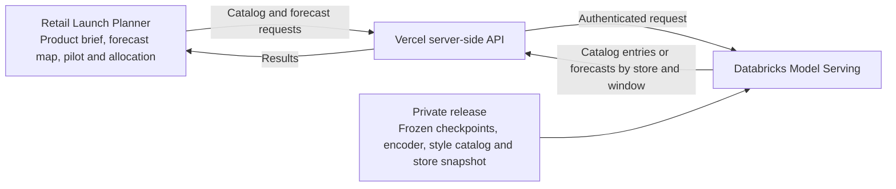
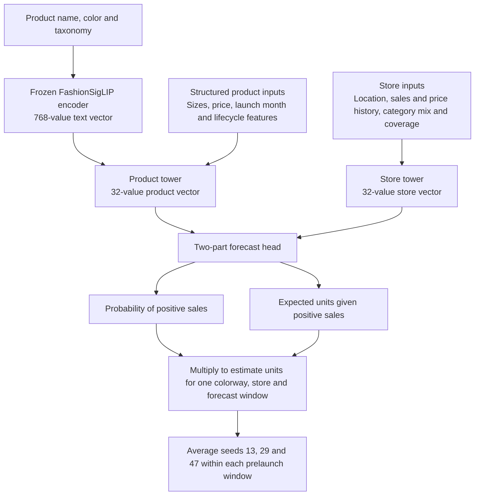

# Retail New Product Launch Forecasting

How many units might a new colorway sell in each store during its first four weeks? This project builds prelaunch forecasts from product attributes and store history, then evaluates whether first-week sales improve the forecast for the remaining launch window.

I built the Databricks modeling tables, the Python forecasting and evaluation workflow, and the Retail Launch Planner. The broader team capstone supplied upstream retail data and shared analysis.

## Retail Launch Planner

1. **Build the product brief.** Enter a new product or choose a catalog style for a new colorway. A catalog style supplies its product name and taxonomy and supplies sizes when available. Enter the launch month and price.
2. **Run the prelaunch forecast.** The planner returns expected unit sales for every eligible store for days 1–14 and 15–28. It maps the store forecasts and sums the two windows for a 28-day outlook.
3. **Plan the rollout.** Compare the highest-forecast pilot with a same-size shortlist that maximizes known metro coverage while retaining at least 90% of the top shortlist's forecast. Enter a network inventory budget to distribute whole units by forecast share.

A labeled sample is available from the planner for exploring the workflow.

### App architecture

### Forecast model architecture

Databricks Model Serving scores each brief against the **May 31, 2026 store snapshot**. The browser uses the returned forecasts to build the map, pilot comparison, and allocation. The original data and serving artifacts are private. The week-one model described below is part of the offline evaluation.

## Databricks data pipeline

Databricks SQL prepares daily sales history at the colorway, store, and day grain. The modeling pipeline uses this history to define launch cohorts, build store features, and assemble outcomes for the forecast windows. Versioned Delta inputs record which data releases an evaluation used. Coverage checks distinguish stores with observed zero units from stores with missing outcomes.

## Models and evaluation

The evaluation compares a category-based baseline, lifecycle LightGBM, and a two-part neural model. The neural model estimates the probability of positive observed sales and the expected units when sales are positive. Their product is the store-level unit forecast.

The prelaunch workflow forecasts days 1–14 and 15–28. A separate workflow uses first-week observations to forecast days 8–28. Historical evaluation respects the forecast issue date and checks how results change when linked product history is excluded. Store-level error, network-level error, and volume bias describe different aspects of forecast performance.

## Source map

- [Retail Launch Planner](app/README.md) describes the workflow, serving setup, and snapshot.
- [Databricks lifecycle table](sql/model_product_color_store_day_lifecycle_v1.sql) builds the daily colorway and store history.
- [Final feature preparation](src/prepare_stage5_final.py) assembles inputs for the forecast windows.
- [Model fitting](src/run_stage5_final_models.py) runs the LightGBM and neural comparisons.
- [Evaluation](src/score_stage5_final.py) computes store and network metrics from matched predictions.
